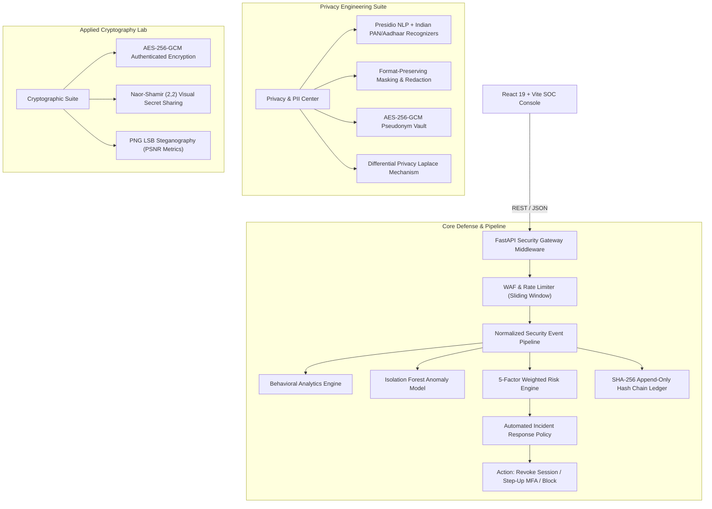

# PRIVASEC: Privacy-Preserving Intelligent Cyber Defense Platform
### Comprehensive Academic & Technical Project Walkthrough for Faculty Evaluation

---

## 1. Executive Summary & Core Motivation

### What is PRIVASEC?
**PRIVASEC** is a full-stack **Cyber Defense and Privacy Engineering Platform**. It unites **proactive security operations** (threat detection, behavioral anomaly analysis, automated incident response) with **privacy-preserving computing** (data minimization, differential privacy, format-preserving masking, deterministic HMAC pseudonymization, and cryptographic secret sharing).

### The Core Problem Solved
Traditional Security Operations Centers (SOCs) collect massive volumes of raw, unencrypted telemetry (IPs, credentials, identity numbers, internal logs) to detect attacks. However, this creates a major regulatory and security paradox: **the SOC itself becomes a high-value surveillance honey pot**, risking violations of data privacy mandates (such as the **EU GDPR**, **HIPAA**, and **India's Digital Personal Data Protection Act / DPDP 2023**).

**PRIVASEC solves this by implementing Zero-Trust Privacy by Design:**
1. Telemetry is pseudonymized and minimized *before* analysis.
2. Threat detection algorithms operate over **pseudonymous identifiers** and **feature vectors**, not raw personal data.
3. Cryptographic controls ensure that re-identification requires elevated multi-tenant authorization, logged into an append-only, tamper-evident hash chain.

---

## 2. System Architecture & Technology Stack



### Technology Stack Table
| Layer | Technologies Used | Key Libraries & Specifications |
|---|---|---|
| **Frontend** | React 19, TypeScript, Vite, Tailwind CSS | Lucide React, Recharts (SOC graphs), Zustand (State), HTML5 Canvas API |
| **Backend API** | Python 3.14, FastAPI, Uvicorn (ASGI) | Pydantic V2, Starlette, Python Multipart |
| **Database & ORM** | SQLite / PostgreSQL (Async), SQLAlchemy 2.0 | `aiosqlite`, `greenlet`, Alembic migrations |
| **Privacy & NLP** | Microsoft Presidio, spaCy (`en_core_web_sm`) | Custom RegEx recognizers with Luhn / Checksum algorithms |
| **Machine Learning** | Scikit-learn, NumPy, Pandas | Isolation Forest (Unsupervised outlier detection) |
| **Applied Cryptography** | Python `cryptography` (Hazmat), Argon2-cffi, PyOTP, Pillow | AES-256-GCM, HMAC-SHA256, SHA-512, TOTP (RFC 6238) |

---

## 3. Deep Dive into the 13 Implemented Modules

### Module 01: Privacy-Preserving Computing & Differential Privacy
* **Code Location:** `backend/app/modules/privacy/diff_privacy.py`
* **What it does:** Allows querying statistical counts across sensitive datasets without disclosing individual participation.
* **Mathematical Implementation:** **The Laplace Mechanism**:
  $$\mathcal{M}(x) = f(x) + Y, \quad Y \sim \text{Laplace}\left(0, \frac{\Delta f}{\epsilon}\right)$$
  - Global Sensitivity $\Delta f = 1$ (adding or removing one individual alters count by at most 1).
  - Scale parameter $b = \frac{1}{\epsilon}$, where $\epsilon$ is the privacy budget.
  - Generates 95% confidence intervals: $\text{Margin}_{95\%} = b \cdot \ln(20) \approx \frac{2.9957}{\epsilon}$.
* **Demonstration in UI:** In the **Privacy Center**, users can adjust $\epsilon$ from $0.1$ to $5.0$, view raw counts vs. perturbed counts, and visualize the privacy-utility tradeoff curve.

---

### Module 02: PII Detection Engine (Presidio + Indian Identity Recognizers)
* **Code Location:** `backend/app/modules/privacy/pii_detector.py`
* **What it does:** Scans text documents (TXT, CSV, PDF) for standard PII (Email, Phone, IP, Credit Cards) plus custom recognizers for Indian identities.
* **How it was implemented:**
  1. **Presidio Analyzer & spaCy:** Named Entity Recognition (NER) pipeline.
  2. **Indian PAN Card Recognizer:**
     - Pattern: `^[A-Z]{5}[0-9]{4}[A-Z]$`
     - Context validation: 4th character entity type check (`P` for Person, `C` for Company, `H` for HUF, `F` for Firm, etc.).
  3. **Indian Aadhaar Recognizer:**
     - Pattern: `\b[2-9]\d{3}\s?\d{4}\s?\d{4}\b` (12 digits, cannot start with 0 or 1, rejects repeated numbers).
  4. **Credit Card Check:** Luhn Algorithm checksum $( \sum d_i \equiv 0 \pmod{10} )$.

---

### Module 03: Data Masking Engine
* **Code Location:** `backend/app/modules/privacy/data_masker.py`
* **What it does:** Sanitizes identified PII according to customizable enterprise redaction policies.
* **Implemented Strategies:**
  - **Format-Preserving Masking:** Retains partial context while hiding sensitive content (e.g., `ABCDE1234F` $\rightarrow$ `XXXXX1234F`; `john.doe@example.com` $\rightarrow$ `j***e@example.com`; `9876543210` $\rightarrow$ `******3210`).
  - **Full Masking:** Replaces the entire token with asterisks (`********`).
  - **Redaction:** Replaces the token with standard entity badges (`[REDACTED: PAN_NUMBER]`).

---

### Module 04: Pseudonymization Vault & Re-Identification
* **Code Location:** `backend/app/modules/privacy/pseudonymizer.py`
* **What it does:** Replaces real identities with deterministic, reversible pseudonyms (`usr_8a3f91...`).
* **Implementation:**
  - **Tokenization:** Domain-separated keyed hash:
    $$\text{Pseudonym} = \text{"usr\_"} + \text{HMAC-SHA256}(K_{\text{pepper}}, \text{identity})[:12]$$
  - **Re-Identification Vault:** Plaintext mapping is encrypted with **AES-256-GCM** using an isolated master key and stored in the database.
  - **Access Control:** Re-identification requires the **Privacy Officer** role and generates an irreversible entry in the audit hash chain.

---

### Module 05: Machine Learning Anomaly Detection
* **Code Location:** `backend/app/modules/intelligence/anomaly.py`
* **What it does:** Unsupervised anomaly detection on multidimensional telemetry vectors.
* **How it was implemented:**
  - Uses an **Isolation Forest** ensemble ($100$ isolation trees).
  - Evaluates 6 normalized features: `request_rate`, `error_ratio`, `off_hours_deviation`, `velocity_score`, `sensitive_endpoint_access`, and `failed_auth_frequency`.
  - **Score Normalization Formulation:**
    The raw scikit-learn decision function $s(x) \in [-0.3, +0.25]$ is mapped to an intuitive $[0, 100]$ SOC severity scale:
    $$\text{Score} = \text{clip}\left((0.18 - s(x)) \times 190.0,\, 0.0,\, 100.0\right)$$
  - Emits **Explainable Feature Attribution** (identifying which specific feature contributed most to the outlier status).

---

### Module 06: Behavioral Analytics Engine
* **Code Location:** `backend/app/modules/intelligence/behavioral.py`
* **What it does:** Establishes a 30-day baseline per pseudonymous user to flag deviations.
* **Metrics Tracked:**
  - **Typical Active Schedule:** Gaussian probability of user activity based on hour of day ($0–23$).
  - **Velocity Score:** Request frequency against exponential moving average (EMA).
  - **Device Novelty:** Cryptographic browser and hardware fingerprint tracking.

---

### Module 07: Explainable 5-Factor Risk Scoring Engine
* **Code Location:** `backend/app/modules/risk/engine.py`
* **What it does:** Synthesizes multiple security telemetry vectors into a unified risk rating $(0–100)$.
* **Mathematical Formula:**
  $$\text{Risk} = \sum_{i=1}^5 w_i \times F_i$$
  $$\text{Weights: } w_{\text{auth}}=0.25, \; w_{\text{behavior}}=0.20, \; w_{\text{ml}}=0.20, \; w_{\text{waf}}=0.20, \; w_{\text{pii}}=0.15 \quad \left(\sum w_i = 1.0\right)$$
* **Risk Action Bands:**
  - `0 – 29` (Low): **ALLOW**
  - `30 – 59` (Medium): **MONITOR** (Logs elevated, telemetry frequency doubled)
  - `60 – 79` (High): **STEP_UP_CHALLENGE** (Forces MFA re-prompt)
  - `80 – 100` (Critical): **RESTRICT_AND_CREATE_INCIDENT** (Automated session revocation & IP quarantine)

---

### Module 08: Web & API Security Gateway (WAF & Rate Limiting)
* **Code Location:** `backend/app/main.py`, `backend/app/routers/security.py`
* **What it does:** Inspects incoming requests for malicious attack payloads and volumetric floods.
* **How it was implemented:**
  - **Sliding-Window Rate Limiter:** Restricts requests per IP/Token (e.g., 60 req/min), enforces 30s lockout on violations.
  - **Heuristic Pattern Matching:** Regex matching for SQL Injection (`UNION SELECT`, `' OR '1'='1`), Cross-Site Scripting (`<script>`, `onerror=`), and Path Traversal (`../`).
  - **Security Headers Injected:** `X-Content-Type-Options: nosniff`, `X-Frame-Options: DENY`, `Strict-Transport-Security`.

---

### Module 09: Adaptive Authentication & MFA
* **Code Location:** `backend/app/routers/auth.py`, `backend/app/models/models.py`
* **What it does:** Multi-layered zero-trust user authentication.
* **Implementation:**
  - **Argon2id Password Hashing:** Memory-hard hashing algorithm resistant to GPU cracking.
  - **TOTP Multi-Factor Authentication (RFC 6238):** Time-based one-time password generation compatible with Google Authenticator / Authy.
  - **QR Code Auto-Enrollment:** Generates base64 PNG QR code containing the `otpauth://` URI.
  - **Role-Based Access Control (RBAC):** Hierarchical permissions for Super Admin, Security Analyst, Privacy Officer, and Standard User.

---

### Module 10: Automated Incident Response & Containment
* **Code Location:** `backend/app/modules/response/policy_engine.py`, `backend/app/routers/incidents.py`
* **What it does:** Orchestrates real-time mitigation when risk thresholds are breached.
* **Capabilities:**
  - Automated session invalidation in database cache.
  - Containment status tracking (`ACTIVE`, `INVESTIGATING`, `CONTAINED`, `RESOLVED`, `ROLLED_BACK`).
  - Full investigation timeline with evidence attribution and operator comments.
  - Safe **Containment Rollback** mechanism for analysts to lift restrictions.

---

### Module 11: Cryptography Suite (AES-256-GCM & Hashes)
* **Code Location:** `backend/app/modules/cryptography/aes_gcm.py`
* **What it does:** Authenticated symmetric encryption for text messages and files.
* **Implementation:**
  - Uses `AESGCM` with a 256-bit key.
  - Generates a unique 96-bit (12-byte) initialization vector (`nonce`) per encryption.
  - Produces a 128-bit authentication tag appended to the ciphertext.
  - Strictly rejects altered ciphertext or forged authentication tags (AEAD guarantee).
  - Offers SHA-256 and SHA-512 cryptographic hash calculators.

---

### Module 12: Visual Cryptography Lab (Naor-Shamir (2,2) Secret Sharing)
* **Code Location:** `backend/app/modules/cryptography/visual_crypto.py`, `frontend/src/pages/VisualCryptoPage.tsx`
* **What it does:** Splits a secret monochrome image into 2 transparent shares such that neither share alone reveals any information, but overlaying them physically reconstructs the secret.
* **Mathematical Construction:**
  - **Expansion Factor:** Each input pixel is converted into a $2 \times 2$ block of 4 subpixels (2 black, 2 white).
  - **White Secret Pixel:** Share 1 gets pattern $P$, Share 2 gets identical pattern $P$. Stacking them results in 2 black + 2 white subpixels (50% transmission).
  - **Black Secret Pixel:** Share 1 gets pattern $P$, Share 2 gets inverted pattern $\overline{P}$. Stacking them yields 4 black subpixels (0% transmission / complete optical extinction).
  - **Information-Theoretic Security:** Single shares have a perfectly uniform distribution across all permutations ($P(S=1 \mid \text{White}) = P(S=1 \mid \text{Black}) = 1/6$).
* **Demonstration in UI:** Generates Share 1 and Share 2 on HTML5 Canvas and features an interactive **Optical Stacking Overlay Slider**.

---

### Module 13: Steganography Lab (PNG LSB + PSNR Image Fidelity)
* **Code Location:** `backend/app/modules/cryptography/steganography.py`, `frontend/src/pages/SteganographyPage.tsx`
* **What it does:** Hides encrypted confidential payloads inside cover images without human-perceptible visual distortion.
* **Implementation:**
  - Encrypts payload using AES-256-GCM.
  - Adds magic header `PSEC` + 32-bit payload length prefix.
  - Injects bits into the Least Significant Bit (bit 0) of the RGB channels:
    $$I_{\text{stego}}[k] = (I_{\text{cover}}[k] \ \& \ \text{0xFE}) \ | \ b_k$$
  - Computes image quality metrics:
    $$\text{MSE} = \frac{1}{M \cdot N \cdot C}\sum (I_{\text{cover}} - I_{\text{stego}})^2, \quad \text{PSNR} = 10 \cdot \log_{10}\left(\frac{255^2}{\text{MSE}}\right)\text{ dB}$$
  - A PSNR score $> 50\text{ dB}$ proves the cover image is visually indistinguishable to the human eye.

---

### Fundamental Infrastructure: Tamper-Evident Hash-Chained Audit Ledger
* **Code Location:** `backend/app/services/audit.py`, `frontend/src/pages/AuditPage.tsx`
* **How it works:**
  - Genesis state: $H_0 = \text{"0000...0000"}$ (64 zeros).
  - Each entry $k$ is chained cryptographically:
    $$H_k = \text{SHA-256}\left(H_{k-1} \,\|\, \text{actor\_id} \,\|\, \text{action} \,\|\, \text{canonical\_json}(\text{meta}) \,\|\, \text{timestamp}\right)$$
  - The UI has a **"Verify Ledger Integrity"** tool that checks all blocks.
  - Includes a **"Simulate Tamper"** test button that modifies a record in the database, allowing the faculty to observe the audit engine detecting the broken chain and locating the exact tampered block index!

---

## 4. Security Posture & STRIDE Threat Model

When presenting to security faculty, explaining the **STRIDE Threat Model** demonstrates professional engineering rigor:

| STRIDE Threat | Potential Attack Vector | PRIVASEC Countermeasure |
|---|---|---|
| **Spoofing** | Credential stuffing, session hijacking | Argon2id password hashing, HttpOnly secure cookies, TOTP MFA, device novelty scoring |
| **Tampering** | Altering audit trails, modifying ciphertext | Append-only SHA-256 hash chaining, AES-256-GCM authentication tag verification |
| **Repudiation** | Operator denying administrative containment | Cryptographic audit ledger with canonical JSON parameters, timestamps, and actor UUIDs |
| **Information Disclosure** | PII leakage in SOC logs | Presidio PII scanning, format-preserving masking, deterministic HMAC pseudonymization |
| **Denial of Service** | API request flooding, brute-force | Sliding-window IP/token rate limiter with automated 30s lockout |
| **Elevation of Privilege** | Cross-tenant data access | Multi-tenant organization scoping on all database queries + RBAC route dependencies |

---

## 5. Live Demonstration Script for Faculty Presentation

Follow this exact order during your presentation for maximum impact:

```
Step 1: Introduction & Login (1 min)
 ↳ Open http://127.0.0.1:5173
 ↳ Show the Quick Role Switcher (Super Admin, Security Analyst, Privacy Officer, Standard User)
 ↳ Explain RBAC and Argon2id password hashing

Step 2: SOC Dashboard & Real-Time Telemetry (1.5 min)
 ↳ Navigate to Dashboard
 ↳ Point out Active Incidents, Risk Distribution, WAF Block Rate, and Anomaly Gauges
 ↳ Explain the Normalized Security Event Pipeline

Step 3: Privacy Engineering Center (2.5 min)
 ↳ Navigate to Privacy Center
 ↳ Enter sample text with PAN and Aadhaar numbers (e.g. "Employee ABCDE1234F with Aadhaar 9876 5432 1098")
 ↳ Click "Scan PII" -> Show Presidio + custom Indian recognizer detection
 ↳ Switch masking strategies (Format-preserving vs Full Redaction)
 ↳ Demonstrate Differential Privacy: Move the Epsilon (ε) slider and show how Laplace noise protects individual records while preserving aggregate counts

Step 4: Machine Learning Anomaly & Risk Engine (2 min)
 ↳ Navigate to ML Anomaly & Risk Scoring pages
 ↳ Show the 5-factor weighted risk model
 ↳ Explain why Isolation Forest was chosen (unsupervised, isolates outliers with minimal trees)
 ↳ Adjust sliders (failed logins, unusual hour, high request rate) to show real-time risk escalation into "RESTRICT"

Step 5: Cryptography, Visual Secret Sharing & Steganography Labs (3 min)
 ↳ Open Visual Crypto Lab -> Generate a secret text -> Show Share 1 & Share 2 (each looks like random static)
 ↳ Drag the Overlay Slider to visually demonstrate optical reconstruction
 ↳ Open Steganography Lab -> Embed encrypted payload into PNG -> Show PSNR > 50 dB proving lossless imperceptibility

Step 6: Audit Hash Chain Tamper Verification (1 min)
 ↳ Open Audit Log -> Click "Verify Integrity" -> Green badge (All blocks valid)
 ↳ Click "Simulate Tampering" -> Re-verify -> Red alert showing exact block broken!
```

---

## 6. Viva Voce Preparation: Likely Faculty Questions & Model Answers

### Q1: Why did you use AES-256-GCM instead of AES-256-CBC?
> **Model Answer:**
> *"AES-CBC provides confidentiality, but does not provide integrity or authenticity. An attacker can perform bit-flipping attacks or padding oracle attacks against CBC mode. AES-GCM is an Authenticated Encryption with Associated Data (AEAD) mode. It combines CTR mode with the Galois Message Authentication Code (GMAC), computing a 128-bit authentication tag. If even a single bit of ciphertext is tampered with, decryption fails immediately without leaking plaintext."*

### Q2: What is the significance of the Privacy Budget ($\epsilon$) in the Laplace Mechanism?
> **Model Answer:**
> *"In $(\epsilon, 0)$-Differential Privacy, $\epsilon$ represents the maximum privacy loss parameter. The noise added is drawn from a Laplace distribution with scale $b = \frac{\Delta f}{\epsilon}$. A smaller $\epsilon$ (e.g., $0.1$) adds higher noise, providing stronger privacy guarantees at the cost of statistical utility. A larger $\epsilon$ (e.g., $2.0$) adds less noise, yielding high utility but lower privacy. Our platform demonstrates this fundamental tradeoff live."*

### Q3: How does Naor-Shamir Visual Cryptography guarantee secrecy without computational assumptions?
> **Model Answer:**
> *"Visual Cryptography provides information-theoretic security, not computational security. Each secret pixel is split into 4 subpixels (2 black, 2 white). The permutation of subpixels in any single share is chosen uniformly at random. Therefore, the probability distribution of pixel patterns in Share 1 is identical whether the secret pixel is white or black: $P(\text{Share}_1 \mid \text{White}) = P(\text{Share}_1 \mid \text{Black}) = \frac{1}{6}$. Mathematically, mutual information $I(S; \text{Share}_1) = 0$."*

### Q4: Why use an Isolation Forest over supervised classification for anomaly detection?
> **Model Answer:**
> *"In real-world cybersecurity, novel zero-day attacks and anomalous behaviors are rare and constantly evolving; there are virtually no balanced, labeled training datasets. Isolation Forest is unsupervised. It explicitly isolates anomalies instead of profiling normal points, exploiting the fact that anomalies are few and have distinct attribute values. This makes tree depth to isolation significantly shorter for malicious attacks."*

### Q5: How is the Audit Log tamper-evident?
> **Model Answer:**
> *"It utilizes a cryptographic hash chain similar to a blockchain. Block $k$ incorporates the SHA-256 digest of Block $k-1$. If an insider or attacker modifies the payload or timestamp of any historical event in the database, the hash computed for that block changes, breaking the link with all subsequent blocks. The verification algorithm detects this discrepancy immediately and pinpoints the exact compromised record index."*
