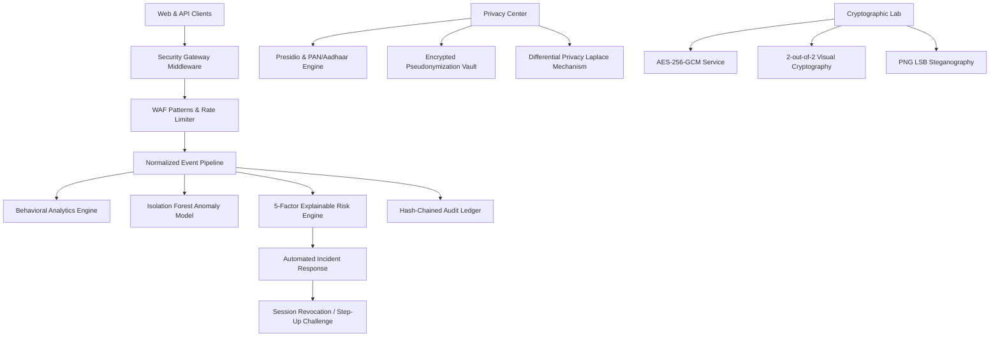

# PRIVASEC Architecture & Engineering Specifications

## 1. System Overview
**PRIVASEC** (Privacy-Preserving Intelligent Cyber Defense Platform) is a full-stack security operations and privacy engineering application. It unites:
1. **Privacy Engineering:** PII identification (Microsoft Presidio + Indian PAN / Aadhaar), deterministic HMAC pseudonymization, format-preserving display masking, differential privacy Laplace mechanics.
2. **Behavioral Analytics:** Rolling baselines across pseudonymous users tracking request rates, off-hours schedules, and device novelty.
3. **Machine Learning Anomaly Detection:** Isolation Forest tree-based scoring normalized to a 0–100 scale with explainable feature attribution.
4. **Adaptive Risk Engine:** 5-factor weighted risk modeling producing actionable containment mandates (Allow, Monitor, Step-Up MFA, Restrict & Incident).
5. **Automated Incident Response:** Configurable policy engine executing session invalidations, step-up prompts, and containment rollback with an immutable investigation timeline.
6. **Cryptographic Suite:** AES-256-GCM authenticated encryption (isolated nonces and tag verification), 2-out-of-2 visual cryptography secret sharing, and PNG LSB steganography with PSNR image fidelity guarantees.
7. **Tamper-Evident Ledger:** Append-only SHA-256 hash-chained audit ledger with block-by-block cryptographic verification.



## 2. Multi-Tenant Organization Isolation
Every table in the database includes an `organization_id` foreign key. Object-level authorization is enforced on every query via the `get_current_session_and_user` dependency, ensuring strict logical tenant isolation.

## 3. Normalized Security Event Pipeline
Every security operation emits a structured event:
```json
{
  "event_id": "uuid",
  "organization_id": "org_uuid",
  "actor_pseudonym": "usr_7f3a",
  "event_type": "AUTH_LOGIN_FAILURE",
  "source": "authentication",
  "severity": "critical",
  "metrics": { "requests_per_minute": 85, "failed_logins_5m": 12 },
  "risk": { "score": 84, "level": "critical", "recommended_action": "RESTRICT_AND_CREATE_INCIDENT" }
}
```
Events flow sequentially through:
1. `BehavioralAnalyticsEngine.compute_deviations()`
2. `AnomalyDetector.evaluate()`
3. `RiskScoringEngine.calculate_risk()`
4. `IncidentResponsePolicyEngine.evaluate_and_respond()`
5. `record_audit_event()`
